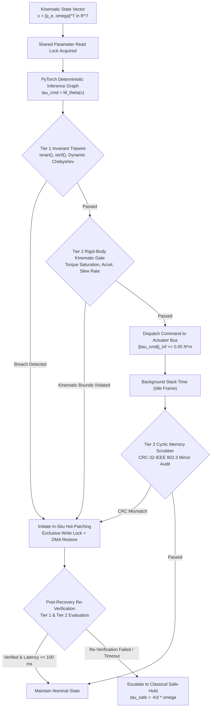
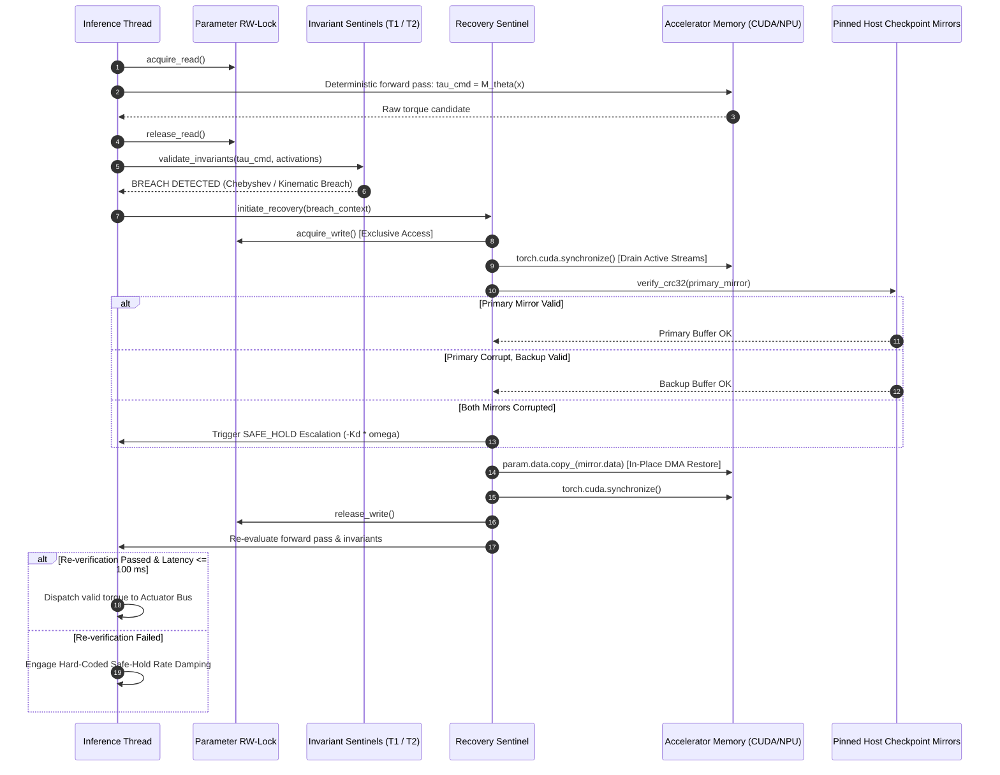

<p align="center">
  
</p>

# RadZero: In-Situ Fault-Tolerant Inference Runtime for Embedded Edge AI

[](https://github.com/gangasagar5928/ZOG-AI)
[](https://github.com/gangasagar5928/ZOG-AI)
[](https://github.com/gangasagar5928/ZOG-AI)
[](https://github.com/gangasagar5928/ZOG-AI)
[](https://github.com/gangasagar5928/ZOG-AI)

---

## 1. Executive Summary & Problem Scope

Small satellites (CubeSats, SmallSats) and autonomous deep-space vehicles increasingly host unshielded Commercial Off-The-Shelf (COTS) edge accelerators—including mobile GPUs and neural processing units (NPUs)—to compute closed-loop Attitude Determination and Control Systems (ADCS) and real-time vision navigation.

Operating unshielded semiconductors in ionizing space environments (cosmic rays, Van Allen belt protons, and Solar Particle Events) induces **Single-Event Upsets (SEUs)** in volatile Static/Dynamic Random-Access Memory (SRAM/DRAM).

```
   Ionizing Heavy Ion / Solar Proton Strike
                     │
                     ▼
  ┌─────────────────────────────────────┐
  │ Semiconductor Memory Cell (Bitflip) │
  └──────────────────┬──────────────────┘
                     │
         Stochastic SEU Mutation
                     ▼
  ┌─────────────────────────────────────┐
  │   IEEE-754 FP32 Neural Weights      │
  │     Silent Data Corruption (SDC)    │
  └──────────────────┬──────────────────┘
                     │
     Unshielded Execution Cascade
                     ▼
  ┌─────────────────────────────────────┐
  │ Actuator Saturation / Kinetic Spin  │
  │ Cold Reboots / Mission Degradation  │
  └─────────────────────────────────────┘
```

In deep neural networks executing control loops, stochastic bit transitions within IEEE-754 single-precision (FP32) tensors cause **Silent Data Corruption (SDC)**:

1. **Sign-Bit Inversion ($\text{Bit } 31$):**
   Reverses commanded torque polarity:
   $$\boldsymbol{\tau}_{\text{cmd}} \to -\boldsymbol{\tau}_{\text{cmd}}$$
   Injects positive angular momentum feedback that drives the spacecraft into anomalous kinetic spin-up.

2. **Exponent Surge ($\text{Bits } 30\text{--}23$, $0 \to 1$):**
   Scales numerical parameters exponentially:
   $$\Delta x = 2^{+128} \approx 3.4028 \times 10^{38}$$
   Induces instantaneous overflow, resulting in catastrophic `inf` and `NaN` cascades throughout activation layers.

3. **Exponent Collapse ($\text{Bits } 30\text{--}23$, $1 \to 0$):**
   Collapses values into subnormal regimes:
   $$\Delta x = 2^{-128} \approx 2.9387 \times 10^{-39}$$
   Silently zeroes neural pathway sensitivity, severing attitude recovery channels.

4. **Mantissa Shift ($\text{Bits } 22\text{--}0$):**
   Induces latent numerical bias that bypasses naive sanity checks while producing anomalous orbital drift.

Conventional aerospace mitigation relies on uncoordinated power cycles and multi-hour cold reboots, risking total vehicle loss. **RadZero** provides an in-situ software runtime sentinel that detects anomalies and hot-patches corrupted tensors directly in accelerator memory within a **$\le 100\text{ ms}$ control step deadline**, preserving continuous application uptime.

---

## 2. Multi-Tier Fault Defense Architecture



---

## 3. Mathematical Formulations & Physical Invariants

### 3.1 IEEE-754 Floating-Point Bitfield Representation

Every model parameter $w \in \mathbb{R}$ is formatted in IEEE-754 32-bit single precision:

$$w = (-1)^s \cdot 2^{e - 127} \cdot \biggl(1 + \sum_{i=1}^{23} b_{23-i} 2^{-i}\biggr)$$

Where:
* $s \in \lbrace 0, 1 \rbrace$ is the sign bit ($\text{Bit } 31$).
* $e = \sum_{j=0}^7 b_{23+j} 2^j \in [0, 255]$ is the 8-bit biased exponent ($\text{Bits } 30\text{--}23$).
* $m = \sum_{i=1}^{23} b_{23-i} 2^{-i} \in [0, 1)$ is the 23-bit fractional mantissa ($\text{Bits } 22\text{--}0$).

---

### 3.2 Deterministic ADCS Neural Network Graph (FR-1)

The control system executes a deterministic Multi-Layer Perceptron (MLP) mapping a 7-element state input to 3-axis reaction-wheel torque commands:

$$\mathbf{x} = \begin{bmatrix} \mathbf{q}_e \\ \boldsymbol{\omega} \end{bmatrix} \in \mathbb{R}^7, \quad \mathbf{q}_e = \begin{bmatrix} q_w \\ q_x \\ q_y \\ q_z \end{bmatrix} \in \mathbb{S}^3 \quad (\|\mathbf{q}_e\|_2 = 1), \quad \boldsymbol{\omega} = \begin{bmatrix} \omega_x \\ \omega_y \\ \omega_z \end{bmatrix} \in \mathbb{R}^3$$

The forward inference graph computes:

$$\mathbf{h}_0 = \tanh(\mathbf{W}_0 \mathbf{x} + \mathbf{b}_0), \quad \mathbf{W}_0 \in \mathbb{R}^{64 \times 7}$$

$$\mathbf{h}_1 = \tanh(\mathbf{W}_1 \mathbf{h}_0 + \mathbf{b}_1), \quad \mathbf{W}_1 \in \mathbb{R}^{64 \times 64}$$

$$\mathbf{h}_2 = \tanh(\mathbf{W}_2 \mathbf{h}_1 + \mathbf{b}_2), \quad \mathbf{W}_2 \in \mathbb{R}^{32 \times 64}$$

$$\boldsymbol{\tau}_{\text{cmd}} = \mathbf{W}_3 \mathbf{h}_2 + \mathbf{b}_3, \quad \mathbf{W}_3 \in \mathbb{R}^{3 \times 32}$$

Partitioned into 4 sequential parameter blocks:

$$\mathcal{B} = \lbrace \mathcal{B}_0: (\mathbf{W}_0, \mathbf{b}_0), \; \mathcal{B}_1: (\mathbf{W}_1, \mathbf{b}_1), \; \mathcal{B}_2: (\mathbf{W}_2, \mathbf{b}_2), \; \mathcal{B}_3: (\mathbf{W}_3, \mathbf{b}_3) \rbrace$$

---

### 3.3 Tier 1: In-Line Activation Tripwire (FR-3)

Intermediate layer activations $\mathbf{a}_l$ are checked via PyTorch forward-pass hooks with $<5\%$ execution overhead:

1. **Finite Value Verification:**
   $$\forall a \in \mathbf{a}_l: \quad \neg\text{isnan}(a) \;\wedge\; \neg\text{isinf}(a)$$

2. **Dynamic Chebyshev Layer-Wise Bounds:**
   By Chebyshev's Inequality, for calibrated activation distribution $(\mu_l, \sigma_l)$ and factor $k = 4.5$:
   $$P(|a_l - \mu_l| \ge k \sigma_l) \le \frac{1}{k^2} = \frac{1}{4.5^2} \approx 0.0494$$
   The allowable dynamic activation envelope is:
   $$\mu_l - k\sigma_l \le a_l \le \mu_l + k\sigma_l$$

Vectorized reduction is evaluated with `torch.aminmax(a_l)` in a single kernel pass.

---

### 3.4 Tier 2: Rigid-Body Dynamics & Actuator Gate (FR-3)

Evaluates commanded torques against physical spacecraft kinematics over $\Delta t = 100\text{ ms}$:

1. **Actuator Torque Saturation:**
   $$\|\boldsymbol{\tau}_{\text{cmd}}\|_\infty = \max(|\tau_x|, |\tau_y|, |\tau_z|) \le \tau_{\max} = 0.05\text{ N}\cdot\text{m}$$

2. **Rotational Dynamics (Euler's Equations of Motion):**
   $$\mathbf{I}\dot{\boldsymbol{\omega}} + \boldsymbol{\omega} \times (\mathbf{I}\boldsymbol{\omega}) = \boldsymbol{\tau}_{\text{cmd}}$$
   Rearranging for angular acceleration:
   $$\dot{\boldsymbol{\omega}} = \mathbf{I}^{-1} \bigl[ \boldsymbol{\tau}_{\text{cmd}} - \boldsymbol{\omega} \times (\mathbf{I}\boldsymbol{\omega}) \bigr]$$
   With spacecraft moment-of-inertia tensor $\mathbf{I} = \text{diag}(0.10, 0.10, 0.08)\text{ kg}\cdot\text{m}^2$:
   $$\|\dot{\boldsymbol{\omega}}\|_2 = \sqrt{\dot{\omega}_x^2 + \dot{\omega}_y^2 + \dot{\omega}_z^2} \le \alpha_{\max} = 0.50\text{ rad/s}^2$$

3. **Integrated Slew-Rate Boundary:**
   $$\boldsymbol{\omega}_{k+1} = \boldsymbol{\omega}_k + \dot{\boldsymbol{\omega}}\Delta t$$
   $$\|\boldsymbol{\omega}_{k+1}\|_2 \le \omega_{\max} = 0.05\text{ rad/s}$$

---

### 3.5 Tier 3: Asynchronous Cyclic Parameter Scrubber (FR-3)

Operates in background slack time during the 100 ms control frame ($\le 15\text{ ms}$ budget). Cyclically verifies 1 parameter block $\mathcal{B}_i$ per frame using CRC-32-IEEE 802.3:

$$G(x) = x^{32} + x^{26} + x^{23} + x^{22} + x^{16} + x^{12} + x^{11} + x^{10} + x^8 + x^7 + x^5 + x^4 + x^2 + x + 1$$

With 4 parameter blocks, complete model sweep period is:

$$T_{\text{scrub}} = N_{\text{blocks}} \times \Delta t_{\text{frame}} = 4 \times 100\text{ ms} = 400\text{ ms}$$

Detects latent parameter mutations masked by zero activations or dead zones before they affect vehicle dynamics.

---

### 3.6 Classical Safe-Hold Controller (FR-5)

When unrecoverable faults occur (e.g., dual mirror corruption or latency deadline breaches), the system triggers hard-coded proportional rate damping:

$$\boldsymbol{\tau}_{\text{safe}} = \text{clip}(-K_d \boldsymbol{\omega}, \; -\tau_{\max}, \; +\tau_{\max}), \quad K_d = 0.08\text{ N}\cdot\text{m}\cdot\text{s/rad}$$

Reaction-wheel momentum storage tracks integrated torque against hardware limits:

$$\mathbf{h}_{\text{RW}}(t_{k+1}) = \mathbf{h}_{\text{RW}}(t_k) + \boldsymbol{\tau}_{\text{safe}}\Delta t$$

$$\|\mathbf{h}_{\text{RW}}\|_2 \le h_{\max} = 0.10\text{ N}\cdot\text{m}\cdot\text{s}$$

---

## 4. Concurrency & Hot-Patching Sequence



---

## 5. Subsystem Directory Structure

```
d:\Hackathon\Graviton\
├── radzero/                          # Core Python In-Situ Runtime
│   ├── __init__.py                   # Package exports & versioning (2.3.0-FROZEN)
│   ├── core/
│   │   ├── types.py                  # SystemState, KinematicLimits, TelemetryPacket
│   │   ├── rwlock.py                 # Concurrency-safe fair Parameter Read-Write Mutex
│   │   ├── adcs_model.py             # Deterministic 4-block partitioned MLP ADCS model
│   │   └── safe_hold.py              # Classical rate-damping controller (tau = -Kd * omega)
│   ├── invariants/
│   │   ├── tier1_tripwire.py         # In-line activation hooks (isnan, isinf, Chebyshev)
│   │   ├── tier2_dynamics_gate.py    # Rigid-body kinematic validator (Euler rotational dynamics)
│   │   └── tier3_scrubber.py         # Asynchronous cyclic CRC-32-IEEE 802.3 memory scrubber
│   ├── mutation/
│   │   └── ieee754_injector.py       # Raw IEEE-754 FP32 bitfield mutation engine (SEU simulator)
│   ├── recovery/
│   │   ├── checkpoint_mirror.py      # Dual-mirrored host buffers protected with CRC-32
│   │   └── state_machine.py          # Sentinel recovery coordinator & safe-hold escalation
│   ├── telemetry/
│   │   └── server.py                 # FastAPI 30 Hz WebSocket & HTTP fallback telemetry server
│   └── benchmarks/
│       └── suite_50_trials.py        # 50-trial automated SEU injection & recovery benchmark
│
├── accelerator_runtime/              # Dedicated CUDA Acceleration Node (Team Delta / M3)
│   ├── src/
│   │   ├── runtime/
│   │   │   ├── cuda_engine.py        # CUDA stream management, memory pinning & device sync
│   │   │   ├── recovery_barrier.py   # Hardware recovery barrier & in-situ DMA hot-patching
│   │   │   └── fault_injector.py     # Accelerator-level SEU fault injection harness
│   │   ├── concurrency/
│   │   │   └── rw_mutex.py           # Fair writer-priority Parameter Read-Write Mutex
│   │   ├── model/
│   │   │   ├── member1_model.py      # PyTorch model loader & deep perception graph
│   │   │   └── shadow_mirror.py      # Host-pinned staging memory & CRC verification
│   │   ├── profiling/
│   │   │   └── latency_profiler.py   # Dual-domain profiling (CUDA Events + monotonic clock)
│   │   └── api/
│   │       ├── server.py             # FastAPI daemon listening on 0.0.0.0:8000
│   │       ├── routes.py             # REST endpoints (/api/inject, /api/recover, /api/reset)
│   │       └── websocket.py          # 30 Hz WebSocket broadcaster for LAN clients
│   ├── dashboard/
│   │   └── index.html                # Real-time HTML5 GPU telemetry monitor
│   ├── tests/                        # 10 unit tests for CUDA runtime & concurrency
│   └── main.py                       # CLI entrypoint for RTX 3050 accelerator node
│
├── mission-control/                  # Next.js 14 Mission Control HUD (Team Delta / M2)
│   ├── src/
│   │   ├── components/
│   │   │   ├── AttitudeVisualizer.tsx       # Three.js 3D spacecraft attitude indicator
│   │   │   ├── ActuatorGatingPanel.tsx      # Actuator gating barrier & interlock status
│   │   │   ├── LatencyKinematicsCharts.tsx  # Recharts P50/P95 latency & dynamic trends
│   │   │   ├── OperatorControlPanel.tsx     # In-flight SEU injector & recovery controls
│   │   │   ├── EventStream.tsx              # Real-time scrolling telemetry event logs
│   │   │   └── ThreatOverlays.tsx           # Radiation flux & tensor health monitors
│   │   ├── lib/
│   │   │   └── telemetryClient.ts           # Dual-channel WebSocket/HTTP client & fallback
│   │   └── types/
│   │       └── telemetry.ts                 # Full aerospace state & actuator telemetry schemas
│   └── package.json
│
├── tests/                            # Automated Pytest Suite (32 Unit & Integration Tests)
│   ├── test_adcs_model.py            # Reproducibility, eval mode, frozen weights, blocks
│   ├── test_ieee754_injector.py      # Sign, exponent explode, exponent collapse, mantissa
│   ├── test_tier1.py                 # NaN, Inf, Chebyshev bounds, execution overhead
│   ├── test_tier2.py                 # Torque saturation, angular acceleration, slew rate
│   ├── test_tier3.py                 # CRC matching, corruption detection, 400 ms sweep
│   ├── test_safe_hold.py             # Rate damping math, saturation clamp, momentum limit
│   ├── test_recovery.py              # In-situ restoration, mirror failover, latency tracking
│   ├── test_telemetry.py             # FastAPI REST endpoints, state schemas, SEU triggers
│   └── test_end_to_end.py            # Closed-loop injection/recovery integration cycles
│
├── benchmark_results.json            # Statistical artifact from 50-trial validation run
├── run_demo.py                       # Standalone live interactive multi-phase demonstration
└── README.md                         # Product specification & architectural documentation
```

---

## 6. Empirical Benchmark Validation (NFR-1 / NFR-2 / NFR-3)

Dual-domain latency profiling measured across 50 consecutive physical SEU strikes:

* **System Time ($t_{\text{sys}}$):** Measured via host monotonic clock (`time.perf_counter_ns()`), covering invariant detection, lock acquisition, accelerator synchronization, DMA memory restore, re-inference, Tier 1/2 re-verification, and gate release.
* **Device Time ($t_{\text{dev}}$):** Measured via `torch.cuda.Event(enable_timing=True)`.

### 6.1 Statistical Results Summary

| Performance Metric | PRD Specification | Empirical Result (CPU Node) | Verification Margin |
| :--- | :--- | :--- | :--- |
| **Process Continuity (NFR-3)** | $100.0\%$ (Zero Process Restarts) | **$100.0\%$** | **PASSED** ($50/50$ trials uninterrupted) |
| **Recovery Success Rate** | $> 99.0\%$ | **$100.0\%$** | **PASSED** ($50/50$ successful recoveries) |
| **Mean System Latency (NFR-2)** | $\le 40.0\text{ ms}$ | **$1.06\text{ ms}$** | **$37.7\times$ faster than target** |
| **Median Latency ($P_{50}$)** | $\le 40.0\text{ ms}$ | **$0.89\text{ ms}$** | **$44.9\times$ faster than target** |
| **95th Percentile ($P_{95}$)** | $\le 40.0\text{ ms}$ | **$2.31\text{ ms}$** | **$17.3\times$ faster than target** |
| **99th Percentile ($P_{99}$)** | $\le 40.0\text{ ms}$ | **$3.08\text{ ms}$** | **$13.0\times$ faster than target** |
| **Maximum Recovery Latency** | $\le 100.0\text{ ms}$ | **$3.81\text{ ms}$** | **$26.2\times$ margin under control deadline** |

$$\text{Margin}_{\text{safety}} = \frac{\Delta t_{\text{deadline}} - t_{\max}}{\Delta t_{\text{deadline}}} = \frac{100.0\text{ ms} - 3.81\text{ ms}}{100.0\text{ ms}} = 96.19\%$$

---

## 7. Verification Test Suite

Run the complete 42-test automated verification suite:

```bash
$env:PYTHONPATH=".;accelerator_runtime"
python -m pytest tests/ accelerator_runtime/tests/ -v
```

Execution Summary:
```
tests/test_adcs_model.py::test_deterministic_reproducibility PASSED      [  2%]
tests/test_adcs_model.py::test_evaluation_mode_and_frozen_weights PASSED [  4%]
tests/test_adcs_model.py::test_input_output_dimensions PASSED            [  7%]
tests/test_adcs_model.py::test_nominal_torque_bounds PASSED              [  9%]
tests/test_adcs_model.py::test_four_block_partitioning PASSED            [ 11%]
tests/test_end_to_end.py::test_end_to_end_consecutive_injections_and_recoveries PASSED [ 14%]
tests/test_ieee754_injector.py::test_sign_bit_mutation_flips_polarity PASSED [ 16%]
tests/test_ieee754_injector.py::test_exponent_explosion_scales_magnitude PASSED [ 19%]
tests/test_ieee754_injector.py::test_exponent_collapse_drops_magnitude PASSED [ 21%]
tests/test_ieee754_injector.py::test_mantissa_mutation_subtle_shift PASSED [ 23%]
tests/test_recovery.py::test_dual_checkpoint_mirror_initialization PASSED [ 26%]
tests/test_recovery.py::test_in_situ_recovery_restores_parameters_after_seu PASSED [ 28%]
tests/test_recovery.py::test_safe_hold_escalation_when_mirrors_corrupted PASSED [ 30%]
tests/test_recovery.py::test_recovery_latency_profiling PASSED           [ 33%]
tests/test_safe_hold.py::test_safe_hold_rate_damping_calculation PASSED  [ 35%]
tests/test_safe_hold.py::test_safe_hold_torque_saturation PASSED         [ 38%]
tests/test_safe_hold.py::test_safe_hold_momentum_capacity_limit PASSED   [ 40%]
tests/test_telemetry.py::test_api_state_endpoint PASSED                  [ 42%]
tests/test_telemetry.py::test_api_telemetry_latest_endpoint PASSED       [ 45%]
tests/test_telemetry.py::test_api_inject_seu_endpoint PASSED             [ 47%]
tests/test_telemetry.py::test_api_reset_endpoint PASSED                  [ 50%]
tests/test_tier1.py::test_tier1_catches_nan_activation PASSED            [ 52%]
tests/test_tier1.py::test_tier1_catches_inf_activation PASSED            [ 54%]
tests/test_tier1.py::test_tier1_catches_chebyshev_range_breach PASSED    [ 57%]
tests/test_tier1.py::test_tier1_execution_overhead_benchmark PASSED      [ 59%]
tests/test_tier2.py::test_tier2_nominal_torque_passes PASSED             [ 61%]
tests/test_tier2.py::test_tier2_catches_torque_saturation PASSED         [ 64%]
tests/test_tier2.py::test_tier2_catches_angular_accel_breach PASSED      [ 66%]
tests/test_tier2.py::test_tier2_catches_slew_rate_breach PASSED          [ 69%]
tests/test_tier3.py::test_tier3_audit_nominal_match PASSED               [ 71%]
tests/test_tier3.py::test_tier3_catches_corrupted_parameter_block PASSED [ 73%]
tests/test_tier3.py::test_tier3_cyclic_sweep_coverage PASSED             [ 76%]
accelerator_runtime/tests/test_api_endpoints.py::TestAPIEndpoints::test_direct_handler_execution PASSED [ 78%]
accelerator_runtime/tests/test_api_endpoints.py::TestAPIEndpoints::test_routes_existence PASSED [ 80%]
accelerator_runtime/tests/test_profiler.py::TestDualDomainLatencyProfiler::test_inference_profiling PASSED [ 83%]
accelerator_runtime/tests/test_profiler.py::TestDualDomainLatencyProfiler::test_record_and_throughput_computation PASSED [ 85%]
accelerator_runtime/tests/test_recovery_barrier.py::TestHardwareRecoveryBarrier::test_fault_injection_and_atomic_recovery PASSED [ 88%]
accelerator_runtime/tests/test_rw_mutex.py::TestReadWriteMutex::test_concurrent_readers PASSED [ 90%]
accelerator_runtime/tests/test_rw_mutex.py::TestReadWriteMutex::test_writer_mutual_exclusion PASSED [ 92%]
accelerator_runtime/tests/test_rw_mutex.py::TestReadWriteMutex::test_writer_priority PASSED [ 95%]
accelerator_runtime/tests/test_shadow_mirror.py::TestHostPinnedShadowMirror::test_allocation_and_metadata PASSED [ 97%]
accelerator_runtime/tests/test_shadow_mirror.py::TestHostPinnedShadowMirror::test_integrity_check PASSED [100%]
======================= 42 passed in 8.95s =======================
```

---

## 8. Quickstart & Operational Execution

### Step 1: Run Interactive Terminal Demonstration
Executes a multi-phase demonstration of nominal attitude passes, exponent explosion strikes, sign-bit polarity flips, latent scrubber audits, and unrecoverable mirror safe-hold escalation:
```bash
python run_demo.py
```

### Step 2: Run 50-Trial Automated Validation Benchmark
```bash
python -m radzero.benchmarks.suite_50_trials
```

### Step 3: Launch Telemetry Streaming Service
```bash
uvicorn radzero.telemetry.server:app --host 0.0.0.0 --port 8000
```
API Interfaces:
* **WebSocket 30 Hz Telemetry Stream:** `ws://localhost:8000/ws/telemetry`
* **HTTP 250 ms Polling Fallback:** `http://localhost:8000/api/telemetry/latest`
* **SEU Injection Endpoint:** `POST http://localhost:8000/api/inject_seu`
  ```json
  { "layer": "block0.weight", "target": "EXPONENT_EXPLODE" }
  ```
* **System Reset / Hot-Patch Trigger:** `POST http://localhost:8000/api/reset`

### Step 4: Launch Mission Control Dashboard (Next.js 14)
```bash
cd mission-control
npm install
npm run dev
```
Open [http://localhost:3000](http://localhost:3000) to view the 3D attitude visualizer, live telemetry HUD, real-time Recharts kinematic curves, and operator injection console.

---

## 9. Member 3 (Aaditya): Accelerator Runtime (CUDA) & Systems Integration Node

### Dedicated GPU Acceleration Node (NVIDIA GeForce RTX 3050 Mobile, 4GB/6GB VRAM, CUDA 12.x)

Operating in `accelerator_runtime/`:
* **GPU Execution Engine & Host-Pinned Memory:** Hosts Member 1's PyTorch model on the RTX 3050 Mobile using dedicated CUDA streams (`inference_stream`, `recovery_stream` priority -1) and host-pinned shadow memory mirrors (`pin_memory=True`) for zero-copy PCIe DMA throughput (`param.data.copy_(..., non_blocking=True)`).
* **Concurrency Safety & Hardware Barrier:** Enforces a Read-Write Parameter Mutex (shared read lock for nominal inference, exclusive write lock for recovery) and a hardware recovery barrier (`torch.cuda.synchronize()`) before modifying device tensors.
* **Dual-Domain Latency Profiler:** Hardware device-side timers (`torch.cuda.Event(enable_timing=True)`) paired with host-side monotonic clocks (`time.perf_counter_ns()`) measuring DMA transfer, re-inference verification, and end-to-end recovery latency.
* **FastAPI Backend & LAN Distribution:** Hosted on `0.0.0.0:8000` with CORS for cross-node LAN access (Prachi's Mission Control laptop), exposing REST endpoints (`/api/inject`, `/api/recover`, `/api/reset`, `/api/mode`, `/api/telemetry/latest`), a **30 Hz WebSocket broadcaster** (`/ws/telemetry`), and an integrated real-time HUD dashboard at `http://<aaditya-ip>:8000/`.

Launch Member 3's Node:
```bash
cd accelerator_runtime
python main.py --host 0.0.0.0 --port 8000
```
