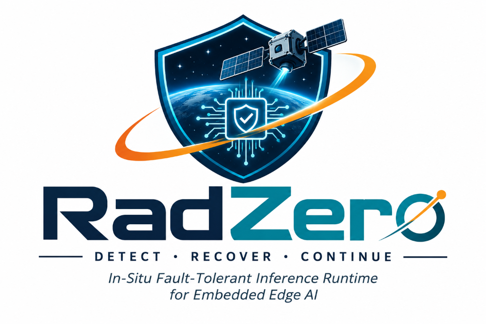
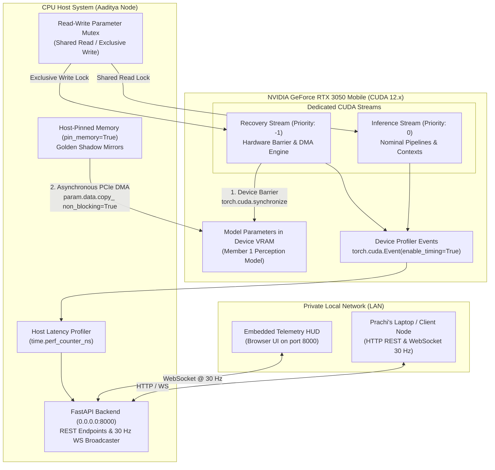

<p align="center">
  
</p>

# Member 3 (Aaditya): Accelerator Runtime (CUDA) & Systems Integration Node

[](https://www.nvidia.com)
[](https://developer.nvidia.com/cuda-toolkit)
[](https://pytorch.org)
[](https://fastapi.tiangolo.com)
[](https://developer.mozilla.org/en-US/docs/Web/API/WebSockets_API)

---

## 1. System Role & Executive Overview

As **Member 3 (Aaditya) — Accelerator Runtime (CUDA) & Systems Integration Lead**, this node operates on the **Dedicated GPU Acceleration Node (NVIDIA GeForce RTX 3050 Mobile, 4GB/6GB VRAM, CUDA 12.x)**.

### Primary Responsibilities:
1. **GPU Execution Engine & Host-Pinned Memory**:
   - Host and execute **Member 1’s PyTorch model** on the RTX 3050 GPU using dedicated CUDA streams and inference contexts (`torch.inference_mode()`).
   - Allocate host shadow mirrors in host-pinned memory (`pin_memory=True`) to maximize PCIe DMA transfer throughput during recovery (`param.data.copy_(..., non_blocking=True)`).
2. **Concurrency Safety & Memory Locking Protocol**:
   - Implement the **Read-Write Parameter Mutex** coordinating nominal inference (shared read lock) and the recovery engine (exclusive write lock).
   - Implement the **Hardware Recovery Barrier**: enforce device-wide synchronization (`torch.cuda.synchronize()`) before modifying device tensors, ensuring in-flight matrix multiplications (cuBLAS GEMM kernels) complete before memory addresses are overwritten.
   - Execute in-place device memory updates (`param.data.copy_()`) from host-pinned buffers under exclusive lock protection.
3. **Dual-Domain Latency Profiler**:
   - Instrument device-side execution using paired `torch.cuda.Event(enable_timing=True)` to measure DMA transfer and re-inference times.
   - Pair device timers with host monotonic clocks (`perf_counter_ns`) to measure end-to-end system recovery latency.
4. **FastAPI Backend & LAN Distribution**:
   - Host the FastAPI application on `0.0.0.0:8000` to allow access from **Prachi’s laptop** over the private local network.
   - Expose REST control endpoints (`/api/inject`, `/api/recover`, `/api/reset`, `/api/mode`) and the **30 Hz WebSocket broadcaster** (`/ws/telemetry`) with graceful disconnect handling.
   - Maintain the `/api/telemetry/latest` HTTP polling fallback endpoint.

---

## 2. Architecture & Data Flow



---

## 3. Subsystem Breakdown

### 3.1. Host-Pinned Memory (Zero-Copy DMA)
Host-pinned memory is allocated via `pin_memory=True`:
- **Why Pinned Memory?** Pinned pages (page-locked) are guaranteed not to be paged out by the OS virtual memory subsystem.
- This allows the RTX 3050's DMA copy engine to transfer data directly over the PCIe bus (`param.data.copy_(host_mirror, non_blocking=True)`) without CPU bounce-buffering, maximizing PCIe bandwidth (typically 5–12+ GB/s).
- Validated via `tensor.is_pinned() == True`.

### 3.2. Concurrency Safety: Read-Write Parameter Mutex
In high-frequency real-time inference (30–100+ FPS), recovering weights must never race with an active inference pass.
- **Shared Read Lock**: Nominal inference requests acquire the read lock concurrently (`with rw_mutex.read_lock():`).
- **Exclusive Write Lock**: The recovery engine acquires exclusive write lock (`with rw_mutex.write_lock():`).
- **Writer-Priority**: Waiting recovery operations prevent new inference readers from starving the recovery queue.
- **Hardware Recovery Barrier**: Before writing to device tensors, `torch.cuda.synchronize(device)` is invoked to ensure in-flight GEMM kernels on the inference stream drain and finish.

### 3.3. Dual-Domain Latency Profiler
Instruments execution across both physical domains:
1. **Device-Side Hardware Clock**:
   - Paired `torch.cuda.Event(enable_timing=True)` records GPU timestamp counters directly on the GPU command queue.
   - Measures raw PCIe DMA transfer time (`dma_start.elapsed_time(dma_end)`).
   - Measures re-inference validation time (`infer_start.elapsed_time(infer_end)`).
2. **Host-Side Monotonic Clock**:
   - `time.perf_counter_ns()` measures lock contention time, barrier sync latency, and end-to-end wall-clock recovery time.
3. **PCIe Throughput Calculation**:
   $$\text{Throughput (GB/s)} = \frac{\text{Bytes Transferred} / 1024^3}{\text{DMA Duration (seconds)}}$$

---

## 4. API Endpoints & LAN Distribution

The service binds to **`0.0.0.0:8000`** with full CORS support so Prachi's laptop can connect without restriction.

| Method | Endpoint | Description |
| :--- | :--- | :--- |
| `POST` | `/api/inject` | Injects simulated hardware faults (bit-flip, NaN, zeroing, noise) |
| `POST` | `/api/recover` | Triggers atomic recovery barrier, PCIe DMA copy, and re-inference |
| `POST` | `/api/reset` | Restores pristine golden weights and resets telemetry stats |
| `GET` | `/api/mode` | Queries active mode (`NOMINAL`, `BENCHMARK`, `FAULT_TEST`) |
| `POST` | `/api/mode` | Sets active operational mode |
| `POST` | `/api/infer` | Executes an inference pass under shared read lock |
| `GET` | `/api/telemetry/latest` | HTTP polling fallback returning complete telemetry snapshot |
| `WS` | `/ws/telemetry` | **30 Hz WebSocket broadcaster** with graceful disconnect handling |
| `GET` | `/` | Cyberpunk Glassmorphic Real-Time Telemetry HUD Dashboard |
| `GET` | `/docs` | Interactive Swagger API Documentation |

---

## 5. Quick Start Instructions

### Prerequisites & PyTorch CUDA Setup
To run with full hardware acceleration on the RTX 3050 Mobile:
```bash
# Install PyTorch with CUDA 12.x support:
pip install torch torchvision --index-url https://download.pytorch.org/whl/cu121

# Install FastAPI and Networking dependencies:
pip install fastapi "uvicorn[standard]" websockets pydantic numpy
```

### Launching the Backend Service
Run on Aaditya's laptop (listening on all network interfaces):
```bash
python main.py --host 0.0.0.0 --port 8000
```

### Accessing from Prachi's Laptop
On Prachi's workstation, open a browser or point frontend client to:
```
http://<AADITYA_LAN_IP>:8000/
```
(Aaditya's console prints the exact LAN IP upon startup, e.g. `http://192.168.1.50:8000`).

### Running the Test Suite
All 10 unit tests run with zero external dependencies in any environment:
```bash
python -m unittest discover -s tests -p "test_*.py"
```
Output:
```
..........
----------------------------------------------------------------------
Ran 10 tests in 0.330s

OK
```
