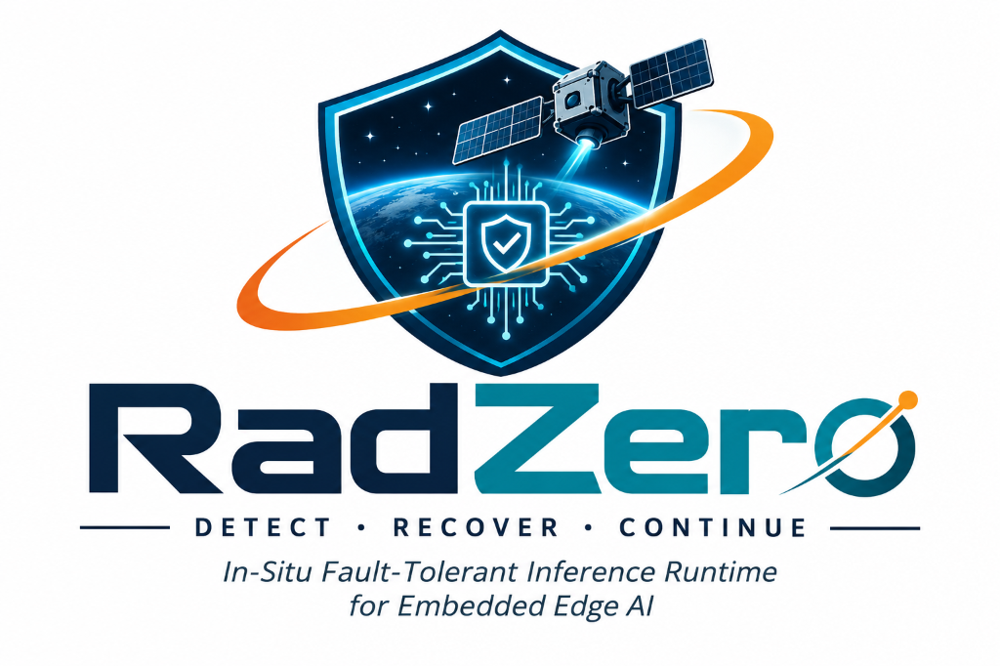

<p align="center">
  
</p>

# ANTIGRAVITY // Mission Control HUD (Aerospace Obsidian v2.4)

**Role**: Member 2 (Prachi) — Frontend & Mission Control UI Lead  
**Hardware Workstation**: UI Development Laptop (Node.js 18+ / Next.js 14 / Tailwind CSS)  
**Primary Focus**: Mission Control HUD, real-time telemetry rendering, dynamic failure-state overlays, and network client routing.

---

## Architecture & Visual Aesthetic

- **Aerospace Obsidian Palette**:
  - Base Background: `#0D1117`
  - Container / HUD Panels: `#161B22`
  - Structural Borders: `#30363D`
  - Accents: Emerald `#10B981` (Nominal), Cyan `#06B6D4` (Recovery), Amber `#F59E0B` (Warning/Inhibited), Crimson `#EF4444` (Breach).

---

## Core Systems Implemented

### 1. Mission Control Scaffolding & Network Client Routing
- Responsive **Next.js 14 App Router** layout engineered for 1080p, 1440p, and 4K mission control displays.
- **Environment Variables**:
  - `NEXT_PUBLIC_BACKEND_URL`: Connects across LAN to **Aaditya’s GPU node IP** (`http://<AADITYA_IP>:8000`).
  - `NEXT_PUBLIC_FALLBACK_URL`: Automated fallback to `http://localhost:8000`.
- **In-Situ Physics Simulator Fallback**: Automatically takes over if neither LAN GPU node nor localhost is reachable, maintaining seamless 60Hz kinematics and attitude dynamics.
- **Interactive LAN Config Modal**: Allows the operator to test live ping latency and re-point the backend URL dynamically at runtime without restarting Next.js.

### 2. Spacecraft Attitude & Dynamics Visualizer (Three.js WebGL)
- Central 3D spacecraft model with satellite bus, MLI thermal blankets, solar array wings, high-gain parabolic antenna, and thruster clusters.
- Directly driven by live quaternion $\mathbf{q} = [q_w, q_x, q_y, q_z]$ and angular velocity $\boldsymbol{\omega} = [\omega_x, \omega_y, \omega_z]$:
  - **NOMINAL**: Smooth celestial tracking, stable attitude, emerald/cyan orientation vectors.
  - **FAULT_ACTIVE (INLINE INVARIANT BREACH)**: Vehicle tumbling active, high angular velocity vector flaring, flashing warning rings.
  - **SAFE_HOLD / RECOVERY_VERIFIED**: Stabilized rate-damping re-alignment, B-dot counter-torque active, convergence to celestial target vector.
- Integrated 2D flight director artificial horizon pitch ladder and center crosshair reticle.
- Real-time quaternion norm $\|\mathbf{q}\|$ validation and Euler angle readouts (Roll, Pitch, Yaw).

### 3. Threat Overlays & Actuator Bus Indicators
- Four Prominent Operational Status Badges:
  1. **`NOMINAL`** (Emerald Green `#10B981`): Lyapunov safety basin verified.
  2. **`INLINE INVARIANT BREACH`** (Pulsing Red `#EF4444`): Tensor safety violation.
  3. **`ACTUATOR INHIBITED`** (Amber Warning `#F59E0B`): Barrier interlock clamped.
  4. **`IN-SITU RECOVERY VERIFIED`** (Cyan `#06B6D4`): Manifold re-projected, rate-damping engaged.
- **Actuator Gating Barrier Panel**:
  - Visual lock gate graphic displaying `COMMANDS PERMITTED` vs. `ACTUATOR INHIBITED`.
  - Interlock latch reason display.
  - Hardware bus channels: RCS Thrusters (Quad 4x), Reaction Wheels (Triad X/Y/Z RPM & Saturation), Magnetorquers (B-Dot damping current), Gimbal Servos.

### 4. Telemetry Feeds & Latency Distribution Charts
- **Scrolling Event Stream**:
  - Millisecond ISO timestamps.
  - Affected tensor layers (e.g. `head.quaternion_regressor.fc1.weight`, `attention.qkv_projection.weight`).
  - Fault-classification causes (e.g. `Single Event Upset (SEU) in Bit 14`, `Tensor Norm Invariant Divergence`).
  - Filter by severity (`ALL`, `CRITICAL`, `RECOVERY`, `WARNING`), live search, freeze/pause stream, and clear log.
- **Recharts Telemetry Graphs**:
  - **Recovery Latency Distributions**: Real-time Area chart tracking $P_{50}$ (median) and $P_{95}$ (95th percentile) latency in milliseconds.
  - **Kinematic Trends**: Multi-line kinematic accelerations ($a_x, a_y, a_z$ in $\text{m/s}^2$) and angular acceleration $\alpha_{\text{total}}$ in $\text{rad/s}^2$.

### 5. Operator Command Console
- **`[Inject SEU Strike]`**: Simulates radiation single-event upset into neural tensor layers, tripping invariant barriers and clamping actuators.
- **`[Trigger In-Situ Recovery]`**: Executes neural checkpoint re-projection, restoring invariants and engaging rate-damping re-alignment.
- **`[Engage Safe-Hold]`**: Manual override engaging B-dot rate damping magnetorquers and sun-pointing lock.
- **`[Toggle Polling Mode]`**: Switches between high-frequency streaming (20Hz / 50ms) and REST polling (4Hz / 250ms).

---

## Running the Application

To launch the Mission Control HUD:
```bash
# Double click start-mission-control.bat or run:
cd mission-control
npm install
npm run dev
```

Open [http://localhost:3000](http://localhost:3000) in your browser.
